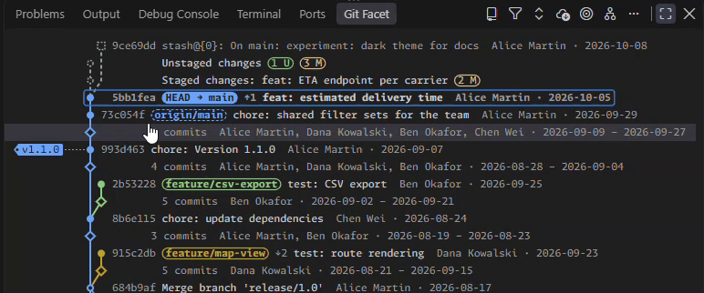
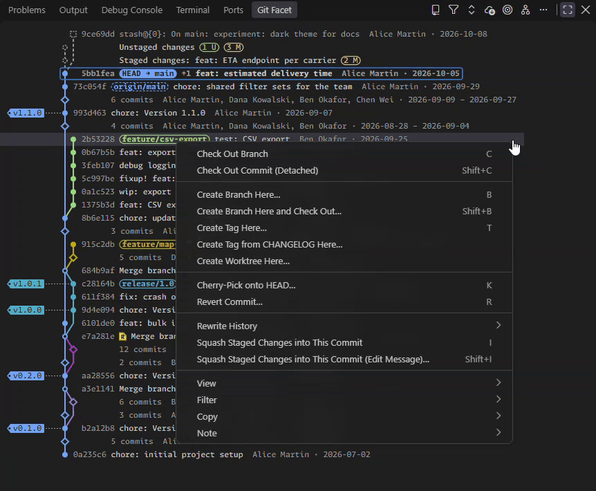
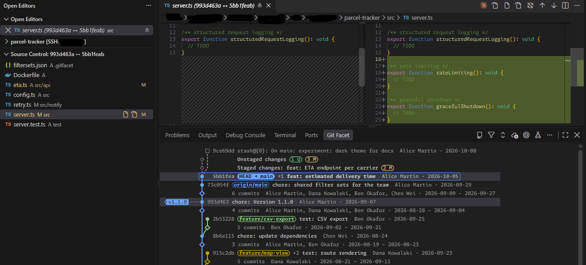

# Git Facet – Condensed Git Graph

**See the shape of your history, not every single commit.**

Git Facet condenses linear runs of commits into a single diamond, so months of history fit on one screen. Click a
diamond to look inside; Shift+click opens it fully.

## Why Git Facet

- **Condensed by default.** Chains become diamonds with a count; only the first parent of a merge is followed until
  you ask for more.
- **Two layouts.** A compact lane graph, or a revision graph with one column per branch and a box for each commit.
- **Filter sets.** Save which branches, authors and paths you want to see, privately or shared with the team in
  `.gitgraph/`.
- **Rewrite history with a preview.** Reorder, squash and drop commits in the graph; Apply runs one `git rebase -i`,
  and Undo takes it back.
- **Everyday Git in place.** Checkout with automatic stash, drag a branch to move it, cherry-pick, merge, push, tags
  from your CHANGELOG, worktrees and git notes.

## Get started

1. Open a folder with a Git repository.
2. Run **Git Facet: Open Graph** from the command palette, or open the **Git Facet** view in the panel.
3. Select a commit to see its changed files; Ctrl/Cmd+click a second one to compare the two.

## Tour

### Two layouts, one toggle

**Revision Graph** / **Compact Graph** in the title bar switches the layout. In the revision graph each branch has
its own column, and arrows point from a commit to the newer one.

### Rewrite history with a preview

Drag a commit onto another to move or squash it, or drop it from the context menu. Every step is only a preview in a
yellow frame until you choose **Apply History Rewrite**.

### Filter sets

Keep views such as "my branches since the release" or "only `src/core`" as filter sets. The status bar shows which
one is loaded, with ● when the graph differs from it.

### Compare and diff

Select two commits, a condensed chain or a range; the changed files appear in **Graph: Changed Files**, and the diff
opens beside the graph and follows your selection.

## Most used keys

Click into the graph first; all keys can be changed under **Keyboard Shortcuts** (search for `gitGraph`).

| Key | Action |
| --- | --- |
| ↑ ↓ / Shift+↑ ↓ | Select a node / select a range |
| → / ← | Expand / collapse a condensed chain |
| Enter | Focus the changed files |
| C | Check out the branch, with stash and unstash |
| B / T | Create a branch / a tag |
| K / R / M | Cherry-pick / revert / merge into HEAD |
| Alt+M | Mark a branch for a move / move it here |
| Shift+R | Start rewriting history at the commit |
| H / V | Hide the commit / show or hide branches |
| E | Edit the filter set |
| Q | Turn condensing on and off |
| Ctrl+F / Alt+Home / Shift+F5 | Find / go to HEAD / fetch all remotes |

Every feature, setting and key is described in the [full reference](docs/REFERENCE.md).

Requires VS Code 1.101 or later and the built-in Git extension. The user interface is available in English and
German.
